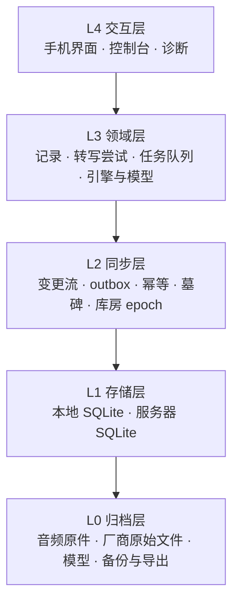
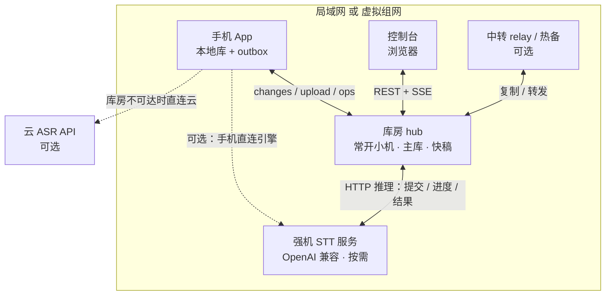
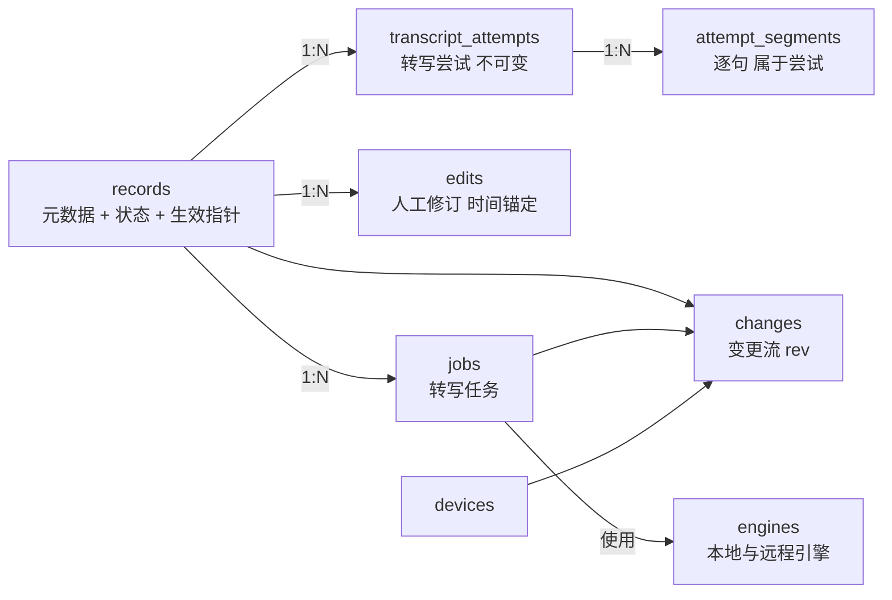
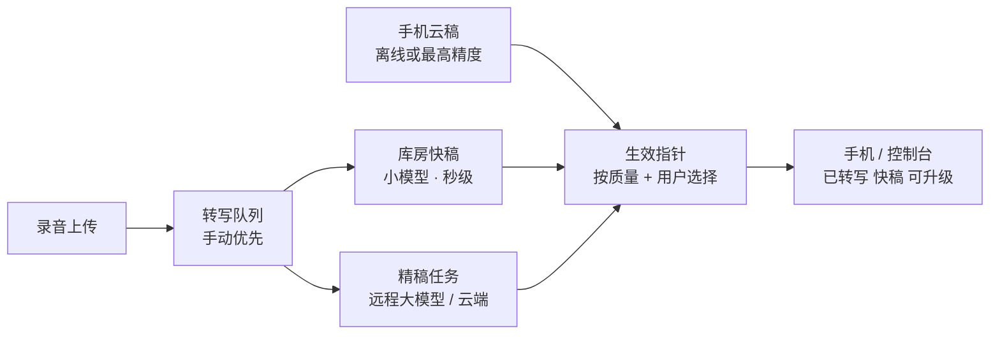
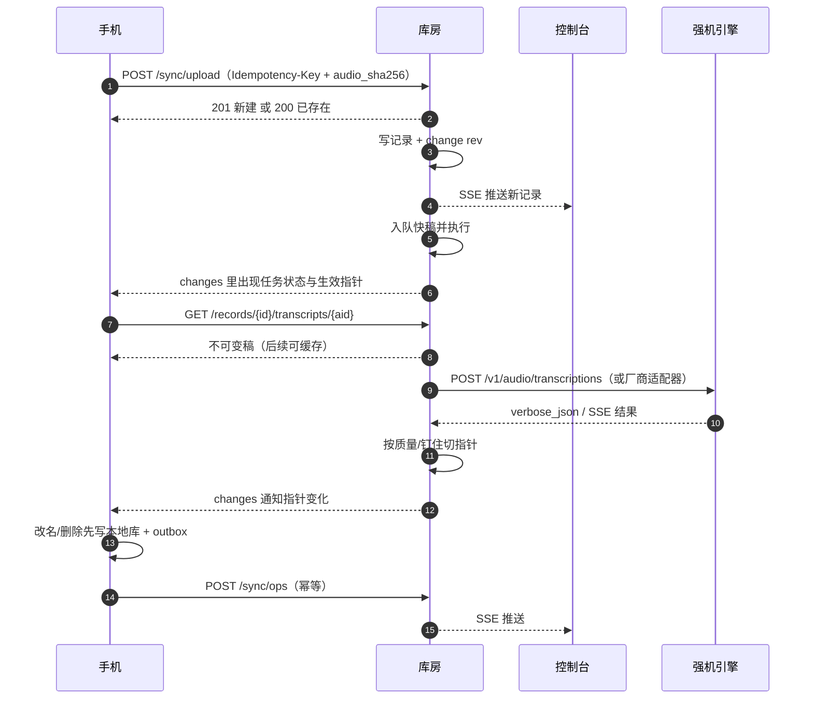
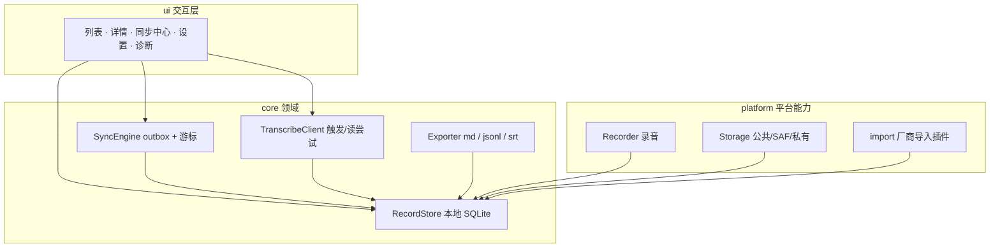

# voxnote 结构设计（v1）

> 2026-10-26。这份文档是重设计后的**完整结构**，作为实现的单一参考。
>
> 配套阅读：[现状体检](DIAGNOSIS.md)（为什么改）、[现在的流程](CURRENT-FLOWS.md)（现在怎么跑）、
> [合理使用流程](USER-FLOWS.md)（用户视角的目标流程）、[重设计准备](REDESIGN.md)（决策记录与迁移路线）、
> [设计手册](DESIGN-PLAYBOOK.md)（方法）。
>
> 本文与 REDESIGN 的目标结构部分重叠时，**以本文为准**；REDESIGN 保留决策背景、迁移步骤与验收。
> 图可在 GitHub / Typora / Obsidian / mermaid.live 渲染。

## 0. 一页看懂



**五条不变量**（违反任何一条都会在换设备、重转写、多端同步时丢数据或打架）：

1. **归档只读**：音频与厂商原始文件是归档，只读不改；结构化事实在库里。
2. **人写内容永不被覆盖**：标题/分类/标记/逐句修订属于人工层，机器派生永远不能覆盖。
3. **机器派生可多版本，只切生效**：转写是可以并存的"尝试"，删除尝试不等于丢数据。
4. **一条事实只存一处**：其余都是索引、缓存、导出或镜像。
5. **单写者**：每类数据只有一个写入口；跨端只通过变更流与幂等操作同步，没有多主同时写。

## 1. 角色与部署

### 1.1 四个角色

| 角色 | 常开 | 职责 | 能写什么 | 不做什么 |
| --- | --- | --- | --- | --- |
| **库房 hub** | 必须 | 唯一数据主库；收录音、发变更、排队调度、可选本地小模型快稿 | 服务器库、音频归档、任务、模型配置 | 不做多主、不自动选主 |
| **引擎端点 engine** | 按需 | 强机上的 **OpenAI 兼容语音转文字服务**（或直接用云厂商 STT） | 不写任何库；只返回转写结果与进度 | 不存数据、不跑控制台、不参与同步 |
| **手机 App** | 一直 | 录音、阅读、编辑、触发转写 | 本地库、outbox、归档音频 | 不直接改服务器库；不依赖在线 |
| **控制台** | 按需 | 阅读、修订、整理、设备/引擎/系统管理 | 通过 hub API 写人工层 | 不直接连数据库 |
| **中转 relay**（可选） | 可选 | 库房不可达时收下待转交包裹 | 短期队列 | 不做主库、不做转写 |

一句话：**数据只有一份主库，算力可以有好几处。**

所以“工位”不再是一个节点，而只是**一个引擎地址**：

- 强机只跑一个很小的转写服务（健康检查 + 提交 + 查进度/取结果），**不需要数据库、控制台、同步服务**；
- 新增强机 = 在控制台加一条引擎配置；下线 = 停用或探测失败；
- 不需要注册、心跳、领任务、结果回写、数据复制这些节点级协议；
- 手机也可以直接调同一个引擎（可选），产出的稿仍然作为“尝试”回传库房。


### 1.2 部署形态



三种落地规模，按需选：

| 形态 | 组成 | 适用 |
| --- | --- | --- |
| 最小 | 一台常开电脑 = 库房；引擎可本地也可远程 | 只有一台机器、接受它常开 |
| 标准 | 常开小机当库房 + 强机只跑 ASR 引擎服务 | **推荐**，强机不开机也能同步和快稿 |
| 完整 | 标准 + 中转 + 热备接管 | 经常在外网、要求不中断 |

多库房规则：同一时刻只有一个主库（单写）。备用库房通过**手动接管**变成主库，
`hub_epoch + 1`；设备/引擎端点拿到新 epoch 后以新库房为准，老库房回来先降级成客户端。
**不做自动选举**——单人场景下"脑裂双写"的代价远大于手动点一下。

**当前阶段（v1）先本机部署**：库房与引擎在同一台电脑，手机走同一局域网同步；
多机（热备/中转/远程引擎）在后置阶段接入。v1 采用**破坏性重建**：不迁移旧数据，
新库从空开始（旧文件保留，建议先手动备份）。

## 2. 分层与依赖

```
L4 交互层：只读本地库/API，不碰文件；负责"显示什么状态、给什么按钮"
L3 领域层：记录、尝试、修订、任务、引擎、模型；不关心 HTTP 与界面
L2 同步层：变更流、outbox、幂等、墓碑、epoch；只搬运与对账
L1 存储层：SQLite + 文件归档；只做持久化，不含业务规则
L0 归档层：音频、厂商原始文件、模型、备份/导出
```

依赖只能向下：`L4 → L3 → L2 → L1 → L0`。
反向依赖（存储层调界面）一律禁止；领域层不 import 任何 UI/HTTP 框架。

## 3. 领域模型

### 3.1 实体

| 实体 | 作用 | 唯一真相在 | 谁写 | 生命周期 |
| --- | --- | --- | --- | --- |
| `records` | 一条录音的元数据 + 状态 + 生效指针 | 服务器库 | 设备经 ops、服务端 | 软删除（墓碑） |
| `transcript_attempts` | 一次转写的结果（不可变） | 服务器库 | 库房/远程引擎/手机引擎/云 | 只增；可清理旧版 |
| `attempt_segments` | 尝试里的逐句 | 服务器库 | 产生尝试时一次写入 | 与尝试同生命周期 |
| `edits` | 人工修订（按时间锚定） | 服务器库 | 手机/控制台 | 永久，跟随记录 |
| `jobs` | 一次转写任务 | 服务器库 | 库房队列 | 终态保留（可归档） |
| `devices` | 手机/控制台身份、游标 | 服务器库 | 设备注册 | 永久/可吊销 |
| `engines` | 引擎端点配置与健康（本地/远程） | 服务器配置 | 控制台/健康探测 | 可停用/删除 |
| `changes` | 单调 rev 的变更流 | 服务器库 | 任何写入 | 保留 N 天，按 rev 清理 |
| `outbox` | 手机待推送操作 | 手机本地库 | 手机 UI | 推送成功即删 |

### 3.2 关系



### 3.3 记录生命周期（对外只有一个状态）

状态机细节见 [USER-FLOWS §4](USER-FLOWS.md)。结构上只保留一个**展示状态**，
由服务器状态 + 本地 outbox 合并得出，任何界面都不自己拼：

| 展示状态 | 来源 |
| --- | --- |
| 仅本机 | 本地有录音，服务器无记录 |
| 待上传 / 待中转 | 本地 outbox 有上传操作 |
| 排队中 / 转写中 N% | 服务器 job |
| 已转写（快稿 · 可升级） | 生效尝试 quality=2 |
| 已转写 | 生效尝试 quality=3，或用户钉住 |
| 失败（原因 + 动作） | record.error_code / outbox.last_error |
| **同步冲突（待选择）** | 存在未解决的 conflict（本地与服务器同改） |
| 已删除 | record.deleted_at |

### 3.4 多来源转写：尝试 + 生效指针



规则（写死，两端可独立算出同样结果）：

- 尝试**不可变**，幂等键 = `record_id + audio_sha256 + source + engine + params_hash`；
- 质量档：`3` 云/远程大模型 > `2` 库房小模型 > `1` 手机小模型；
- 默认指针 `rank = (用户钉住?, quality_tier, created_at)`；用户钉住优先；
- 切指针只改 `records.active_attempt_id`（跟 rev 走），旧稿永远保留、可对比、可切回；
- 手机离线时本地按同一规则算"临时生效"，联网后以库房指针为准，界面提示"本地已升级，待同步"。

### 3.5 人工修订：挂在时间区间上，保留历史并支持 diff

- `edits` 记录 `anchor_t_ms / anchor_e_ms / original_hash / text / spk / deleted`；
- **append-only 历史**：每次修订新增一条记录（含操作者、时间、基于哪个 attempt），
  **不覆盖旧版本**；生效值 = 该锚点上最新一条；
- **支持 diff**：任意两个版本（或旧稿 vs 当前稿）可对比，界面高亮增删改；
- **并发修改不静默覆盖**：检测到本地与服务器同改（`base_rev` 不再匹配）时，
  生成一条 `conflict`，界面提醒用户并展示两边版本，让用户选择"用本地/用服务器/逐项合并"；
  **元数据冲突按记录、逐句修订冲突按句，两类都做**；选择结果作为新修订写入历史，
  双方版本都保留可追溯；
- 读取生效稿 = 当前生效尝试的句 + 按时间重叠套用 edits；
- 重叠度低于阈值时，界面提示"这句修订基于旧稿，可能错位"，让用户确认/丢弃；
- **任何一次重转写都不改 edits**，这是"人写内容永不被覆盖"的落点。

### 3.6 删除：只做标记，清理集中到"存储管理"

- **默认删除不动源文件**：不删音频、不删导出、不物理删库；只置 `records.deleted_at` +
  UI/数据库标记，并从列表/搜索/播放入口隐藏；
- 删除进变更流（墓碑），两端一致、可恢复；没有"物理真删就同步不到"的路径；
- **真正的清理是一个显式动作**：设置页提供"存储管理"，集中列出并清理
  （已删除记录的音频/导出、旧转写版本、临时文件、备份旧代），清理前显示占用与预览，
  用户确认后执行；
- 这样"删除很快、可撤销"，"释放空间"与"删数据"分开；避免误删和跨端不一致。

### 3.7 可测试的不变量

1. 同一条记录，任何时候最多一个 `active_attempt_id`；
2. 任何一次重转写/切指针，`edits` 数量与内容不变；
3. 同一请求重放（同 op_id / 同 sha）不改变最终状态；
4. 删除后重新拉取，设备本地不再出现该记录；
5. 两个端从同一 rev 出发，应用同一批 changes 后状态一致；
6. 任何界面的展示状态都能由库里的字段算出来，不依赖文件存在性；
7. `edits` 只追加，历史可回溯；任意两个版本可 diff；
8. 删除只改标记，源文件在"存储管理"清理动作执行前保持不变；
9. 未解决的冲突不会静默丢失任一边：两个版本都能在历史里找到，直到用户选择。

## 4. 存储结构

### 4.1 服务器 SQLite（摘要）

```sql
records(id TEXT PK, rev INTEGER, legacy_id TEXT, deleted_at INTEGER,
        title, cat, mode, src, device_id,
        recorded_at, dur_ms, bytes, audio_path, audio_sha256 UNIQUE,
        status, engine, error_code, error_hint,
        active_attempt_id, active_pinned,
        created_at, updated_at)

transcript_attempts(id TEXT PK, record_id, rev,
        audio_sha256, source, engine, model, params_hash,
        quality_tier, cost_hint, duration_ms, created_at,
        UNIQUE(record_id, audio_sha256, source, engine, params_hash))

attempt_segments(attempt_id, idx, t_ms, e_ms, text, spk)

edits(id TEXT PK, record_id, rev,
      anchor_t_ms, anchor_e_ms, original_hash,
      text, spk, deleted, edited_at)

jobs(id, record_id, engine, source, state, stage, progress,
     error_code, error_hint, priority, cancel_requested,
     queued_at, started_at, finished_at)

devices(id PK, name, kind, app_version, last_seen_at, last_cursor, status)

engines(id PK, kind, name, url, token, model,
        quality_tier, slots, timeout_ms, enabled)

conflicts(id PK, record_id, kind, base_rev,
           local_payload_json, server_payload_json,
           created_at, resolved_at, resolution)
  -- 并发修改的待选择项；两个版本都保留，用户选择后写历史

changes(rev INTEGER PK AUTOINCREMENT, kind, entity_id, created_at)
settings(k PK, v)
```

### 4.2 文件布局（服务器 `data/`）

```
data/
  voxnote.db                 工作真相（SQLite）
  audio/<yyyy.MM>/<id>.<ext> 音频归档（只读）
  exports/<id>/{transcript.md, segments.jsonl, transcript.srt}
  models/                    所有模型（Whisper / Qwen / 声纹）
  backups/                   sqlite .backup + 关键配置快照
  tmp/                       转码临时，可清
```

- `exports/` 是导出物，可删可重建，不参与业务判断；
- 模型统一放 `data/models`，不依赖全局缓存目录；下载有大小/哈希/磁盘预算；
- 备份 = `sqlite3 .backup` + `audio/`（exports 可不备）。

### 4.3 客户端 SQLite（Android framework）

```sql
records(id PK, server_rev, local_dirty, deleted,
        title, cat, marks_json, recorded_at, dur_ms,
        audio_path, audio_uri, audio_sha256,
        display_status, engine, error_code, error_hint,
        active_attempt_id, active_pinned, updated_at)

attempts(id PK, record_id, server_rev, source, engine,
         quality_tier, segments_json, created_at)

edits(id PK, record_id, anchor_t_ms, anchor_e_ms,
      original_hash, text, spk, deleted, dirty, edited_at)

jobs(record_id PK, job_id, source, state, stage,
     progress, error_code, error_hint, updated_at)

outbox(op_id PK, kind, record_id, payload_json, base_rev,
       created_at, attempts, next_retry_at, last_error)

sync_state(k PK, v)   -- cursor / last_sync_at / device_id / epoch
```

- 本地库是**工作真相**：列表、详情、搜索全部读它；
- 音频仍按现有三种位置（公共/SAF/私有）归档，库里只存路径与哈希；
- md/jsonl 只在"导出"时生成，**不再被反解析成事实**。

## 5. 同步结构

### 5.1 五条规则

| 规则 | 做法 |
| --- | --- |
| 版本 | 服务器 `rev` 单调递增；客户端存游标，按 rev 拉变更 |
| 删除 | 墓碑进变更流；设备删本地副本，不复活 |
| 幂等 | 上传 = `Idempotency-Key` + `audio_sha256` 唯一；操作 = `op_id` |
| 分页 | `changes?cursor&limit` 返回 `next_cursor + has_more`，必须拉到追平 |
| 派生多版本 | 转写稿按 attempt 不可变拉取，换指针不重传全文 |

### 5.2 API 表面积（`/api/v2`）

| 方法 | 路径 | 用途 |
| --- | --- | --- |
| GET | `/sync/changes?cursor=&limit=` | 拉变更（记录/任务/指针/墓碑） |
| GET | `/sync/manifest?cursor=&limit=` | 全量对账清单（id/rev/deleted/sync_hash，分页） |
| GET | `/sync/conflicts` | 未解决的并发修改冲突（两边版本） |
| POST | `/sync/conflicts/{id}/resolve` | 选择本地/服务器/合并，写入历史 |
| POST | `/sync/upload` | 上传音频（幂等、可续传） |
| POST | `/sync/ops` | 批量本地操作（改元数据/删除/修订/重转/钉版） |
| GET | `/records/{id}` | 记录详情（元数据 + 尝试列表 + 任务） |
| GET | `/records/{id}/transcripts/{aid}` | 某次尝试的稿（不可变，可缓存） |
| POST | `/records/{id}/transcripts` | 回传一次尝试（手机云稿） |
| POST | `/records/{id}/active-transcript` | 切生效稿（或 `auto`） |
| POST | `/records/{id}/transcribe` | 触发转写（幂等复用活跃任务） |
| DELETE | `/records/{id}` | 墓碑 |
| GET | `/records/{id}/audio` | 下载音频（支持 Range） |
| GET | `/events` | SSE：任务/记录/指针变化（控制台） |
| GET | `/engines` | 引擎端点清单（本地/远程）与就绪状态 |
| POST | `/engines` | 新增/更新远程引擎（地址、令牌、模型、质量档、并发） |
| POST | `/engines/{id}/test` | 连通与自检（模型/显存/延迟） |
| DELETE | `/engines/{id}` | 停用/删除引擎 |
| GET | `/cluster/info` | 库房信息、epoch、能力 |
| POST | `/cluster/promote` | 备用库房接管 |
| GET | `/diagnostics` | 设备/引擎/队列诊断 |
| GET | `/health` | 子系统健康（db/queue/engine/disk） |

### 5.3 一次上传与拉取



### 5.4 冲突规则：提醒用户，让用户选

**不静默覆盖**。检测到两边基于同一 `base_rev` 各改了一份时，进入冲突待处理：

| 数据 | 规则 |
| --- | --- |
| 标题 / 分类 / 标记 | 进冲突列表；展示"本地版本 vs 服务器版本"，用户选择用哪边或逐项合并 |
| 逐句修订 | 同上；两边版本都保留在修订历史里，可 diff 后选择/合并 |
| 转写稿 | 不做冲突：多尝试并存，只切生效指针 |
| 删除 vs 修改 | 提醒用户确认：恢复记录或确认删除；不静默复活也不静默删除 |
| 库房切换 | `hub_epoch` 大者为准；老库房降级为客户端 |

冲突未解决时：记录显示"同步冲突（待选择）"，不阻塞其它记录同步；选择结果写一条
`resolution` + 新修订，两边原文都留在历史里。

### 5.5 失败与重试

- 所有客户端写操作先进 `outbox`，状态机：`待推送 → 推送中 → 成功 / 失败(退避重试) / 冲突(需用户处理)`；
- 网络/5xx：指数退避（5s/30s/2m/10m），永久可重试；
- 4xx 业务错误：不重试，进"需处理"列表，带原因与动作；
- 上传支持分块/Range 续传，按 sha256 校验；
- 服务端请求全部幂等，重复投递不会产生副本。

### 5.6 长期离线：用"状态对账"根治，哈希是其中一环

**问题本质**：增量同步假设"游标之后的变更历史仍然存在"。变更流只保留 N 天，
设备离线超过 N 天，游标指向已被清理的区间，被清掉的新增/改名/**删除**永远补不回来——
删除没有痕迹，最难发现。这不是"离线久"，是**参照系被清理**。

**根本解法：不再依赖历史长度，改为"服务器权威的全量对账"（state reconciliation）。**

- 服务器提供清单：`GET /sync/manifest?cursor=&limit=` → 分页返回
  `[{id, rev, deleted, sync_hash}]`，只含标识、版本、删除标记、内容哈希，不含正文；
- 客户端重连时**先推** outbox（本地改动），再拿 manifest 与本地集合对账：
  - 服务器有、本地无 → 拉取；
  - 两边 `rev` 不同 → 拉取；若本地也有未推送改动，**生成冲突待用户选择**（不静默覆盖）；
  - 服务器标记 `deleted` → 删除本地；
  - 本地有、服务器无（且不是待上传的本地记录）→ 删除或提示"幽灵记录"；
- `sync_hash` 是**规范化后的记录哈希**：元数据（标题/分类/标记）+ `active_attempt_id`
  + `edits` 版本 + `deleted`，固定字段顺序、排除设备本地字段（路径、本地时间）；
  用来快速判断"这条要不要拉/重建"，也用于完整性自检；
- 对账拿全后，把游标更新到服务器当前 rev；**之后照常走 changes 增量**。

**触发对账的条件**：游标比服务端最旧 rev 还老、服务端返回 `resync_required`、
用户点"强制对账"、或每周自检一次（防 bug 累积漂移）。离线没超过保留期就正常增量。

**哈希能做什么、不能做什么**：

- 能做：快速发现差异、避免无脑全量下载、完整性自检、去重（`audio_sha256`）；
- 不能做：哈希只说"不同"，不能决定"谁对"（要服务器权威 + `rev`）、
  不能表达删除意图（要墓碑或全集合）、不能替代冲突规则；
- 所以它是**对账的加速器**，不是同步机制本身。

**规模与进阶**：manifest 只传 `id + rev + hash`，10k 条约 1MB 量级，压缩后更小，先够用；
记录数再上一个量级（10 万+）或按流量计费时，再升级成 **Merkle 树**（按 id 排序分桶，
先交换根哈希，再逐层下钻到差异桶），把对账从 O(N) 降到 O(log N + 差异数)。
两者共用同一套"应用/合并"逻辑，升级不影响业务层。

**删除的保证**：服务器 manifest 就是权威集合；本地非 pending 的记录不在清单里即视为删除。
这样即使墓碑被清理，对账仍能纠正；墓碑继续保留用于增量传播与"误删恢复"。

## 6. 转写结构

### 6.1 流水线

快稿保底、精稿升级、云端兜底：

1. **库房快稿**：收到录音立即用小模型转，几秒到几十秒出可读稿（quality=2）；
2. **远程引擎精稿**：强机上的 OpenAI 兼容 STT 服务在线时，库房提交音频并取回精稿（quality=3）；
3. **手机直转**：库房不可达、或用户要求最高精度时，手机直连远程引擎或云 API（quality=3）；
   凭据两种模式：库房代理（Key 不落手机，默认）或手机本地 Key（离线可用）。
   v1 **不自动切云/切引擎**，失败提示用户手动选择（自动切换见 #8）。

### 6.2 队列

- 单任务并发（本地引擎顺序跑最快、避免 GPU 抢占；远程引擎按其声明槽位并发）；
  手动任务优先级高于自动；
- 阶段：`loading_model → decoding → transcribing → finalizing`；
- 取消：queued 直接取消；running 置标记，句边界退出（远程引擎走取消端点）；
- ETA：按本机/引擎 RTF 滑动平均估，显示"约 N 分钟"；
- 失败自动重试只针对可重试错误（网络/超时/GPU 回退），其余直接带原因失败；
- **引擎选择（v1）**：可配置多个 API / 引擎地址，但**用户手动选择、不自动切换**；
  调用失败只提示原因，由用户手动改选；自动降级后置（#8）。不可达的引擎标灰、不默认选它。

### 6.3 引擎就绪（readiness）

`ready() = 依赖 import 成功 + 模型文件存在且校验通过 + 可选的快速自检`。
未就绪时：`/engines` 显示原因；自动入队**落显式状态**（`ENGINE_NOT_READY`），
禁止"静默停在 raw"；手动触发返回可执行提示（下载模型/换引擎/用云端）。

### 6.4 错误码（两端同一份）

| code | 人话 | 动作 |
| --- | --- | --- |
| `AUDIO_DECODE` / `AUDIO_MISSING` | 音频解不开 / 不在了 | 转 16k wav / 从设备重传 |
| `ENGINE_NOT_READY` / `MODEL_MISSING` | 引擎没准备好 | 下载模型 / 换引擎 |
| `GPU_RUNTIME` | 显卡运行库缺失 | 切 CPU 重试 |
| `EMPTY_RESULT` | 没识别到语音 | 确认不是静音 / 重试 |
| `TIMEOUT` | 超时 | 重试 / 换云端 |
| `CLOUD_AUTH` / `CLOUD_QUOTA` | Key 无效 / 配额用尽 | 改 Key / 等额度 |
| `STORAGE_FULL` / `PERMISSION` | 磁盘或权限 | 清理空间 / 改路径 |
| `INTERNAL` | 未归类 | 重试 + 展开原始异常 + 导出诊断 |

分类规则：**先看异常类型，再看因果链关键词**；禁止只靠子串匹配。

### 6.5 实时与增量

- 转写中：内存累积 + 每 2–3 秒把脏区间写库；**导出镜像只在完成时写**；
- 控制台通过 SSE 看进度；手机前台用 changes 拉（10s，可见时加速，后台退避）；
- 新增句追加渲染，已读内容不重建，滚动位置保持；
- 完成后新增尝试 + 切指针，不逼手机重新下载全文。

### 6.6 远程引擎：直接用 OpenAI 兼容的语音转文字 API（不自造协议）

**结论：不自造引擎协议。** 语音转文字已经有事实标准——OpenAI 的
`POST /v1/audio/transcriptions`（multipart），自托管和云服务大量实现它
（LocalAI、Speaches 等本地服务，Groq 等云服务，以及 Azure OpenAI）。
库房只需要写一个**适配器**，强机直接跑现成服务，不用为 voxnote 写一行服务端代码。

标准请求（multipart）：

| 字段 | 用途 |
| --- | --- |
| `file` | 音频文件（wav/mp3/m4a/ogg…，由服务端 ffmpeg 解码） |
| `model` | 引擎上的模型名（如 `whisper-1` / `Systran/faster-whisper-small`） |
| `language` | 语言提示（`zh` / `auto`） |
| `response_format` | `json` / `text` / `srt` / `vtt` / `verbose_json` |
| `timestamp_granularities[]` | `segment` / `word`，拿句级/词级时间戳 |
| `stream` | `true` 时走 SSE 增量（部分实现支持） |
| `temperature` / `prompt` | 采样与上下文提示 |

响应（`verbose_json`）通常包含 `text`、`language`、`duration`、`segments[]`
（`start / end / text`，部分实现带 `speaker`）。句级时间戳正好是 voxnote 需要的。

库房侧的适配器规则：

- **引擎配置**只有：`base_url + api_key + model + quality_tier + timeout + slots`；
- **健康检查**：优先 `GET /v1/models` 或 `/health`；没有就"乐观可用 + 首次失败降级"；
- **能力降级**：有 `verbose_json` 用句级时间戳；只有 `text` 就整篇当一段（或按标点切）；
  有 `stream` 用它做近似进度；没有就按音频时长估进度；
- **说话人**：不是标准字段。LocalAI 用 `diarize=true` 扩展，Deepgram/AssemblyAI 等
  用自己的参数；统一在适配器里映射成 `spk`，拿不到就标 `-1`；
- **取消**：标准 API 没有取消语义，断开连接即可（服务端应停止计算）；
- **长音频**：同步请求可能超时。策略：库房侧任务异步化 + 长超时；太长就本地按 VAD
  切片分别调用；厂商有异步 job API（AssemblyAI 等）就写对应适配器；
- **幂等**：标准请求没有幂等键。由库房侧保证——同一 `record + audio_sha256 + params`
  的结果只落一份尝试，重复提交直接复用。

适配器接口（库房内部，所有来源统一）：

```
transcribe(audio_file, params) -> {
    segments: [{t_ms, e_ms, text, spk?}],
    engine, model, language, duration_ms
}
```

- `OpenAICompatibleEngine`：覆盖 LocalAI / Speaches / whisper.cpp 封装 / Groq / Azure OpenAI 等；
- `VendorEngine`：Deepgram / AssemblyAI / 阿里云 / 腾讯云 / 讯飞等各写一个小适配器（各自协议的差异收敛在这里）；
- 手机直连：同一套 `base_url + token + model`，产出尝试经 outbox 回传库房；默认仍走库房代理。

**voxnote 自己的扩展（可选，不是协议前提）**：如果自建服务想要精确进度/取消/说话人，
再加一个可选的 `GET /health` 或 `stream=true` 能力；引擎没实现就按标准批量模式工作。

这样“工位”就消失了：**新增强机 = 加一条 OpenAI 兼容的引擎地址**，
不需要注册、心跳、领任务、结果回写、数据复制，也不需要自定义协议。

## 7. 客户端结构（代码）

### 7.1 包结构



### 7.2 线程模型

| 线程 | 做什么 | 禁止 |
| --- | --- | --- |
| 主线程 | 读本地库快照、绑定视图、响应输入 | 读写文件、网络、解析大文本 |
| DB 写线程 | 所有本地库写入（单写者） | 直接回调 UI |
| IO 线程 | 上传/下载/录音发布/导出 | 直接改 UI |
| Sync 线程 | outbox 推送 + changes 拉取 | 长任务（转码等） |

UI 通过观察者刷新：`RecordStore` 变化 → 发"哪些记录变了" → 列表/详情只更新这些行。

### 7.3 数据访问规则

1. 界面只读本地库，不读 md、不 stat 文件推断状态；
2. 用户操作 = 写本地库 + 写 outbox（同一个事务），然后由 SyncEngine 推送；
3. 同步回填 = 事务内应用 changes（元数据/尝试/任务/墓碑），完成后通知变更集合；
4. md/jsonl 只在导出时生成；外部导入只在显式扫描/首次启动时发生，按文件身份增量；
5. 手机可以直连远程引擎（离线/高精度场景），但产出的稿必须作为"尝试"经 outbox 回传库房；
   默认走库房代理，手机不保存引擎令牌。

### 7.4 渲染规则

- 列表：复用 ViewHolder；只 bind 变化行；
- 详情：按 `active_attempt` 变化只替换稿子区域；转写中追加新句，不重建全部；
- 失败：统一失败卡（原因 + 动作 + 展开原始异常）；
- 同步/任务状态变化只更新对应 chip，不整页重绘。

## 8. 服务端结构（代码）

| 模块 | 职责 | 不做什么 |
| --- | --- | --- |
| `api/` | HTTP/SSE 路由、鉴权、请求校验 | 业务规则 |
| `domain/record` | 记录、尝试、修订、指针、墓碑 | 不碰文件路径细节 |
| `domain/transcribe` | 队列、任务状态、优先级、取消、错误码 | 不决定 UI |
| `engines/` | 引擎实现 + readiness + 注册表 | 不调度队列 |
| `models/` | 模型下载/校验/磁盘预算 | 不转写 |
| `sync/` | changes、outbox 应用、幂等、epoch | 不认识具体功能 |
| `store/` | SQLite、文件归档、导出、备份 | 不含业务判断 |
| `web/` | 单文件控制台（SSE + 增量渲染） | 不直连数据库 |

- 单进程：FastAPI + SQLite（WAL）+ 任务调度线程 + SSE 广播；
- 所有写路径统一走 `RecordService`，保证每次写入都产生 rev 与 change；
- 远程引擎的配置、健康探测、提交/取消/结果回收走同一套鉴权与幂等；引擎本身无状态。

## 9. 交互结构

### 9.1 唯一状态词表（全端一致）

`仅本机 · 待上传 · 待中转 · 排队中 · 转写中 N% · 已转写（快稿） · 已转写 · 失败（原因） · 已删除`

技术层可以有 record/job/sync 多个维度，**展示层只翻译成这一套**；来源（库房/远程引擎/云）只作附注。

### 9.2 手机：三个 tab + 三个覆盖层

| 位置 | 内容 | 主入口 |
| --- | --- | --- |
| 记录 tab | 列表 + 顶部同步条 + 搜索 + 筛选 + 录音按钮 | 点录音、点卡片 |
| 同步 tab | 同步中心：待上传 / 转写中 / 失败 / 最近一轮 | 顶部同步条 |
| 设置 tab | 录音 / 存储 / 服务器地址簿 / 转写（只读就绪）/ 诊断 / 关于 | 首次向导 |
| 详情覆盖层 | 播放条 + 任务卡 + 逐句稿 + 标记 + 改名/分类 | 点卡片 |
| 扫码覆盖层 | 配对二维码 | 设置 → 扫码 |
| 选择器/菜单 | 分类、引擎、存储方式 | 对应行 |

规则：**同一件事只有一个入口**；同步不再藏在设置里；转写不再有第二套配置；
"录音流"并入记录页的"连续阅读模式"，不再单独一个 tab。

### 9.3 控制台：三个主区

| 区域 | 内容 |
| --- | --- |
| 记录库 | 列表（状态长在行上）+ 筛选/搜索 + 详情（读、播放、修订、切版本、导出） |
| 同步与设备 | 设备/引擎/库房状态、游标、待处理、失败、重传 |
| 系统状态 | 引擎就绪、模型清单、队列、最近失败、磁盘、诊断 |
| 设置 | 只放配置（服务器/存储/引擎/AI），不再混设备与模型管理 |
| AI 助手 | 延后到主线稳定后再放回来 |

规则：取消独立"转写任务"页（状态长在记录上，另设活动中心）；3 秒轮询改 SSE。

### 9.4 入口规则

1. 每个任务只有一个入口，主路径上只放一个主按钮；
2. 默认行为优先，高级选项收进"高级/诊断"，设置项越少越好；
3. 失败必须带原因 + 下一步；
4. 任何新功能先挂到主路径某一步，挂不上就不做（见 [设计手册](DESIGN-PLAYBOOK.md)）。

### 9.5 首次配对向导

扫码 → 连通测试 → 引擎就绪检查（缺模型给指引）→ 试转一条 → 完成。
允许"先跳过"：没有服务器也能录音和本地阅读，只是暂不同步。

## 10. 可观测性与诊断

- 诊断页（手机/控制台）：版本、设备 id、游标、epoch、outbox、最近同步事件、
  最近失败（code/hint/原始异常折叠）、引擎/模型状态、数据目录与磁盘余量；
- `/health`：db / queue / engine / model / disk 分项；
- 指标：`sync_lag`、`outbox_size`、`queue_depth`、`job_duration_p50/p95`、
  `failure_codes`、`upload_retries`、`attempts_per_record`；
- 结构化日志（JSON lines）带 `record_id / job_id / op_id / rev`，一条链能串起来；
- 镜像/导出失败不影响主流程，但必须留痕。

## 11. 安全与隐私

**当前策略（功能优先）**：安全边界只做最小必要，完整威胁模型排到功能完善之后（见 #7）。

- **隐私提示只在调用外部 API 时出现**：一旦把音频/转写稿发给云端 ASR 或 AI，
  明确提示"数据将交给第三方 API 处理"；本地引擎、库房内部调用不打扰用户；
- 设备令牌一机一令牌、可吊销；控制台鉴权建议开启；
- 数据位置：音频与库默认只在自托管机器；云调用是显式动作；
- 模型下载记录来源与哈希，不静默替换；
- 日志脱敏、备份加密、SSRF、手机直连令牌等细节：见 #7，功能收尾后统一处理；
- 隐私红线不变：日志/数据库/录音/抓包不进仓库。

## 12. 性能与可靠性预算

| 指标 | 预算 |
| --- | --- |
| 列表冷启动（1k 记录） | < 1s |
| 打开详情 | < 300ms |
| 一次 changes 拉取 | < 300ms / 请求，无 `since=0` 全量 |
| 上传断点续传 | 支持 Range/分块，失败不重传全文 |
| 转写中手机可见延迟 | ≤ 2s（进度 ≤ 5s） |
| 数据库写入 | 批量/事务；转写中每 2–3s 一次，不整表删插 |
| 备份 | 每日一次 sqlite backup + 音频增量；可一键接管 |
| 可恢复性 | 任意设备丢失可从主库恢复；主库丢失可从备份 + 音频重建（修订除外） |

## 13. 演进与验收

阶段划分见 [REDESIGN §10](REDESIGN.md)，这里只列顺序：

1. **P0 止血**：失败可见、上传幂等、changes 分页与游标修正、最小墓碑；
2. **P1 结构**：客户端 SQLite + outbox + changes/ops；服务端 rev/墓碑/尝试/幂等/冲突；
3. **P2 交互**：手机同步中心/任务卡/冲突选择/设置重组；控制台 IA + SSE + 增量渲染；
4. **P3 转写**：readiness、模型目录、队列优先级、错误码、快稿/精稿升级；
5. **P4 多服务端**：OpenAI 兼容引擎接入（含手机直连）、热备接管、中转、凭据模式。

**迁移策略：破坏性重建，不迁移历史数据。** 新版本从空库开始；旧数据库/旧 md/app-state
不导入、不兼容，旧文件保留在原位置（建议先自行备份一份再切换）。因此不再需要迁移脚本与
对账演练，只需要"备份 → 清空/换新库 → 上线"和回滚演练。

验收以 [USER-FLOWS §10](USER-FLOWS.md) 的 5 个任务脚本 + 本文 §3.7 不变量 + §12 预算为准；
每个阶段跑"备份/恢复演练"和"回滚演练"。

## 14. 明确不做

- 多主同时写、自动选主、跨机实时协作编辑；
- 抓取/注入厂商私有数据（导入只读公开文件）；
- 为了少写代码牺牲一致性（如用轮询代替变更流、用文件推断状态）；
- 手机端引入第三方框架（纯 Java + framework SQLite）；
- 云端绑定单一供应商（引擎可插拔，凭据可换）。

## 15. 决策记录（2026-10-26 已拍板）

| # | 决策 | 结论 |
| --- | --- | --- |
| 1 | 客户端本地库 | **用 framework SQLite** |
| 2 | 协议升级 | **接受破坏性 v2**（v1 保留只读兼容） |
| 3 | 多服务端 | 结构按库房 + 远程引擎设计，但 **v1 先本机部署**，多机后置 |
| 4 | 转写来源 | 服务端主路径 + 远程引擎 + 手机直转兜底 |
| 5 | 质量排序 | 云/远程强机 > 库房 > 手机，可钉住 |
| 6 | 云 Key | 默认库房代理，可选手机本地 Key |
| 7 | 快稿默认 | **开**（可关） |
| 8 | 引擎协议 | **OpenAI 兼容 `/v1/audio/transcriptions`**，不自造协议 |
| 9 | 删除语义 | **默认只做 UI/数据库标记，不动源文件**；清理集中到设置页"存储管理" |
| 10 | 修订 | **保留历史版本，允许用户 diff** |
| 11 | 隐私 | **只在调用外部 API 时提示**"数据将交给第三方 API 处理"，本地调用不打扰 |
| 12 | v1 范围 | 只做：录音 / 列表 / 详情 / 自动转写 / 同步 / 搜索 / 改名分类；录音流、AI、批量、多引擎切换、摘要待办、导入插件 **暂不做** |
| 13 | 用户数 | **v1 仅限单用户**（不做家庭共享/多账号） |
| 14 | 迁移 | **破坏性重建，放弃所有历史数据**；不写迁移脚本；旧文件保留但新库不导入 |
| 15 | 保留策略 | 墓碑 / 旧尝试 / 修订历史 / 备份代数 **在设置页可配置**；默认：墓碑 90 天、旧尝试 3 版/30 天、修订历史永久、备份每日 7 代 |
| 16 | 冲突处理 | **提醒用户，让用户选择用本地还是服务器版本**（不静默覆盖，两边历史都保留）；**元数据按记录、逐句修订按句，全部做** |
| 17 | 分类体系 | **标签**（非目录）；id 稳定、名称可改；跨端按 id 同步，重名/改名提示；支持合并 |
| 18 | 云端 | **默认允许调用云**（调用前按隐私策略提示）；**暂不做计费/预算**功能；**v1 不自动切云**，失败提示手选 |
| 19 | 发布与部署 | **暂不管**（继续本机开发部署；release 签名/分发后置） |
| 20 | 多引擎 | 可配置多个 API / 引擎；**v1 手动选择、不自动切换**，失败只提示；自动切换后置（#8） |

**后置项（已开 issue，主干后再做）**：

- 转写质量策略（低置信/幻觉/热词/混语种）→ #6；
- 安全边界（SSRF/手机直连令牌/局域网明文/备份加密）→ #7；
- 后台录音 → #1；整库导出/导入 → #2；说话人身份 → #3；存储与备份 → #4；零散清尾 → #5。
