# 现在的流程（只读推导）

> 2026-10-26。**只读代码推导，未改任何代码。**
> 画的是**当前实现实际怎么跑**，不是应该怎么跑；目标形态见 [合理使用流程](目标流程.md)，
> 问题清单见 [体检报告](../分析/现状体检.md)。所有 mermaid 图可在 GitHub / Typora / Obsidian /
> mermaid.live 渲染。

## 0. 一句话总览

现在不是一个流程，而是**三条流程并行**，靠 `<id>.md` 文件在中间对账：

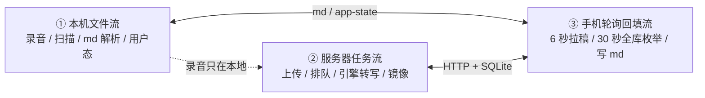

三条流各自有状态、各自写数据；用户看到的界面，是第 ① 条流把文件系统重新解析一遍的结果。
这就是"为什么同步和转写总是对不上"的结构原因。

## 1. 入口地图（手机 App）

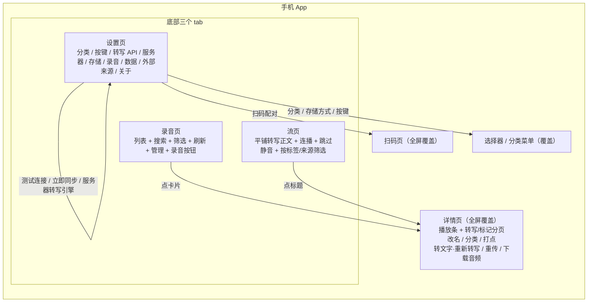

证据：`HomeActivity.java:374-445`（三个 tab）、`:447` 列表页、`:232` 详情、`:315-331`
扫码、`SettingsScreen.java:176-496`（九组设置）。控制台另有 6 个页面（见 §8）。

## 2. 启动与列表：每次都是"全库重解析"

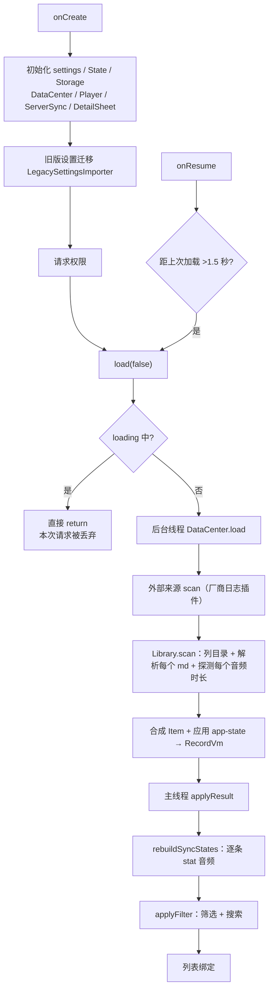

证据：`HomeActivity.java:172-247, 929-933, 1676-1684`；`DataCenter.java:97-162`；
`Library.java:59-84, 88-116, 242-263`；`MdParser.java:57-125`。
注意：没有缓存/增量，"刷新"和"同步回填后"走的都是这一整条。

## 3. 录音：本机成功，后续是"待办标记"

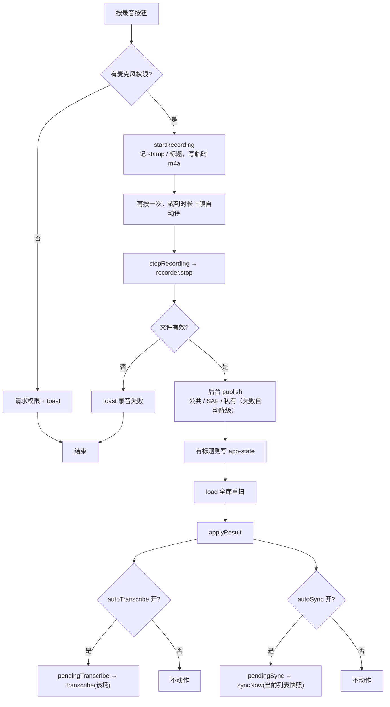

证据：`HomeActivity.java:1508-1592`；默认值见 `UiSettings.java:29,48,50`（自动转写/自动上传/自动音频**默认关**）。
`transcribe()` 的分支见 §7：有服务器走服务器，没有服务器就变成"重扫外部来源"。

## 4. 同步：三种触发、两条线程、靠 md 对账

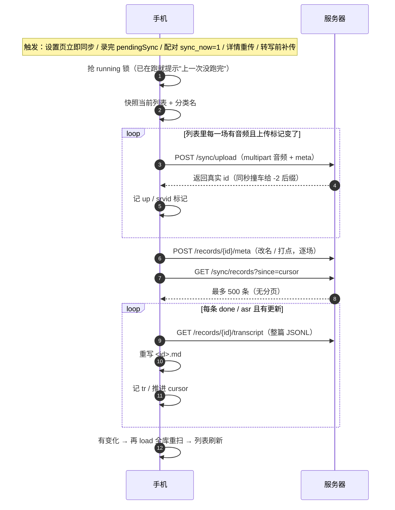

三种触发器各自独立：

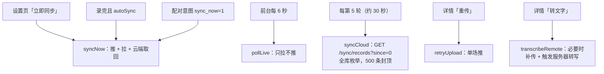

证据：`ServerSync.java:143-194`（syncNow）、`:206-223`（push）、`:278-310`（pushMeta）、
`:642-730`（pull）、`:868-1003`（syncCloud）、`:1049-1078`（pollLive）、
`HomeActivity.java:1714-1728`（6 秒 / 30 秒）；`api_sync.py:161-174`（LIMIT 500）。

## 5. 服务端转写：单 worker + 每 3 秒全量落库

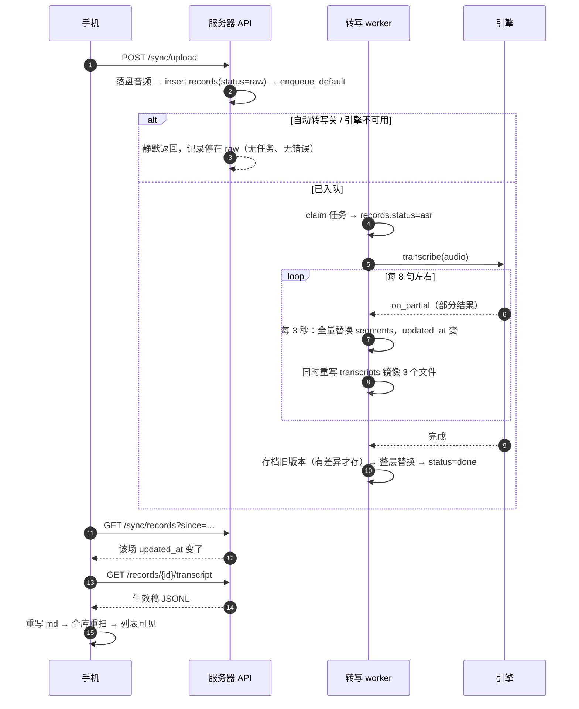

失败时：异常被归类成人话写进 `records.error`，记录 `status=fail`；**同步 feed 不返回失败原因**，
手机 pull 又直接跳过非 done/asr 的记录——所以手机端无感（见 §6、§10）。

证据：`api_sync.py:72-140`；`jobs.py:96-106, 173-283`；`db.py:224-255, 400-436`；
`ServerSync.java:707-711`。

## 6. 手机上的"状态"全是推导出来的

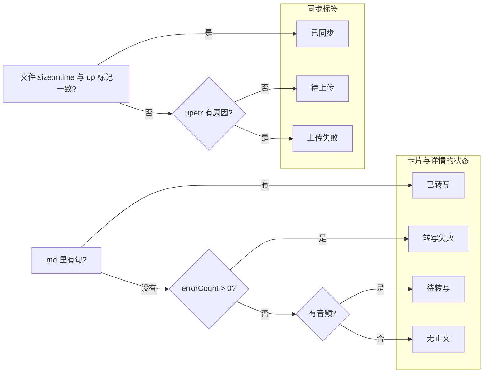

关键：手机**没有** `queued / asr / 转写进度 / 服务器失败原因` 这些状态——它们只存在于服务器，
`/sync/records` 也不返回，所以手机不可能显示。
证据：`RecordVm.java:92-97`；`ServerSync.java:358-371, 707-711`；`api_sync.py:161-174`。

## 7. 详情页：打开、刷新、以及"转文字"的真实分支

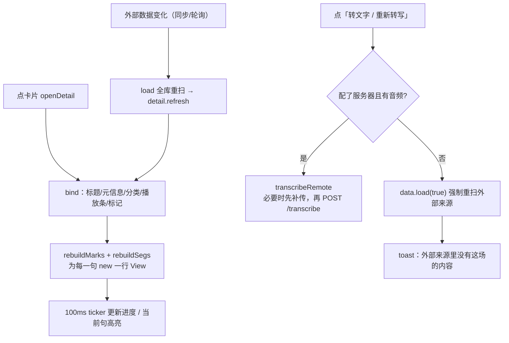

按钮的显示规则也是推导的：`uploadBtn` 只在同步状态=FAIL 时出现；`audioBtn` 只在
"云端场次且本机没音频"时出现；`transcribeBtn` 文案由本地状态决定。
证据：`DetailSheet.java:573-627, 870-927`；`HomeActivity.java:1352-1386`。

## 8. 控制台：6 个页面 + 3 秒轮询 + 整块重建

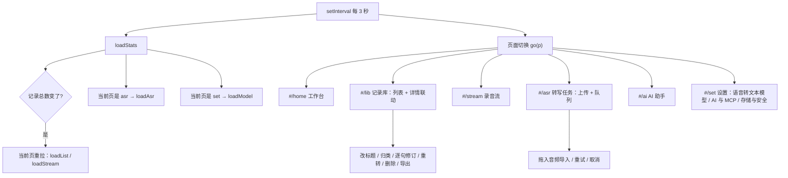

证据：`index.html:633-666`（hash 路由）、`:2379`（3 秒轮询）、`:700-753`（stats 驱动刷新）、
`:954-1164`（记录库 + 详情）、`:1780-1812`（任务页）、`:1925-2063`（设置三 tab）。

控制台改一次东西到手机看到，要走两步完全不同的同步：

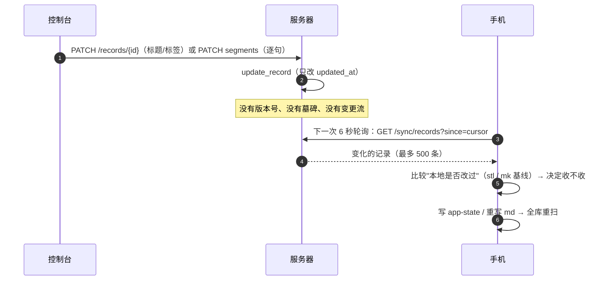

## 9. 五处真相：同一件事存在五个地方

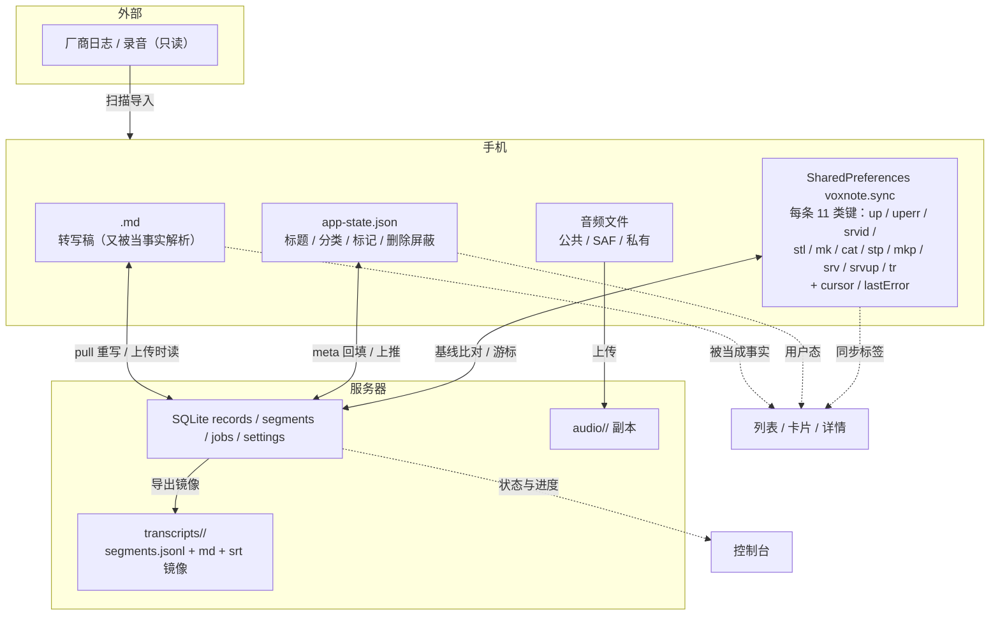

这就是"改了又变、删了回来、两端不一致"的结构来源：没有单一真相，只有一组规则在维持同步。

## 10. 现在的用户实际会走到的分支（死路图）

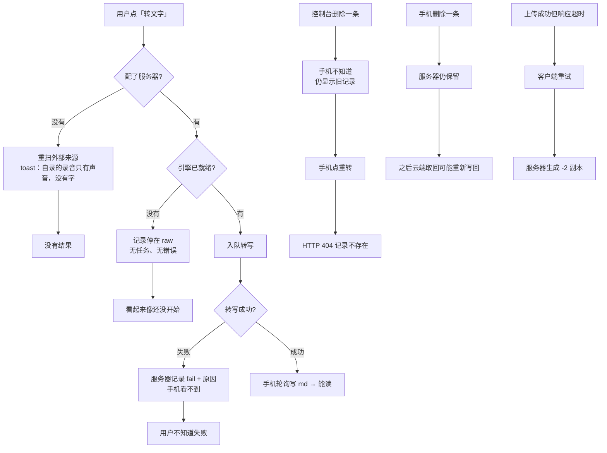

证据：§5、§6 与 [体检报告](../分析/现状体检.md) 的 A1/A3/A4/C2/C3。

## 11. 现状 vs 目标：差在哪

| 维度 | 现在（本文推导） | 目标（USER-FLOWS） |
| --- | --- | --- |
| 流程数量 | 三条并行，md 对账 | 一条主线，状态驱动 |
| 手机状态 | 由文件推导（4 种） | 由服务器 + 本地合并（一套状态） |
| 转写可见性 | 只看到"有/没有 md" | 排队/进度/快稿/精稿/失败原因 |
| 同步方式 | 6 秒 + 30 秒轮询、全库枚举 | 变更流 + 游标增量 |
| 删除 | 不传播 | 墓碑双向 |
| 多来源转写 | 后写覆盖（无位置） | 尝试 + 生效指针 |
| 数据真相 | 5 处 | 每类事实 1 处 |
| 失败 | 多数无感/误报 | 统一失败卡 + 下一步 |

## 12. 只读推导结论

1. **现状不是一个"软件流程"，是三段各自成立的机制**：文件扫描、服务器队列、客户端轮询。
   它们之间唯一的合同是 `<id>.md` 和 `updated_at`，所以任何一处改动都容易对不上。
2. **手机没有"服务器状态"这个概念**，一切靠文件推导；所以排队、进度、失败原因在手机上根本无处显示，
   不是 UI 没做，是数据没来。
3. **同步是"轮询 + 全量重放 + 基线比较"**，不是变更流；删除、幂等、分页、多来源都没有位置，
   只能继续加规则/加键来补，复杂度会继续涨。
4. **控制台和手机是两套完全不同的读写路径**（SQLite vs 文件），所以"改了又变"是结构必然。
5. 因此重设计的顺序必须是：**先定真相（库）→ 再定状态机 → 再定变更流 → 最后才是界面**；
   在现状上继续加功能，只会把这三条流程越拉越远。
