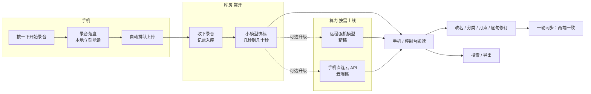
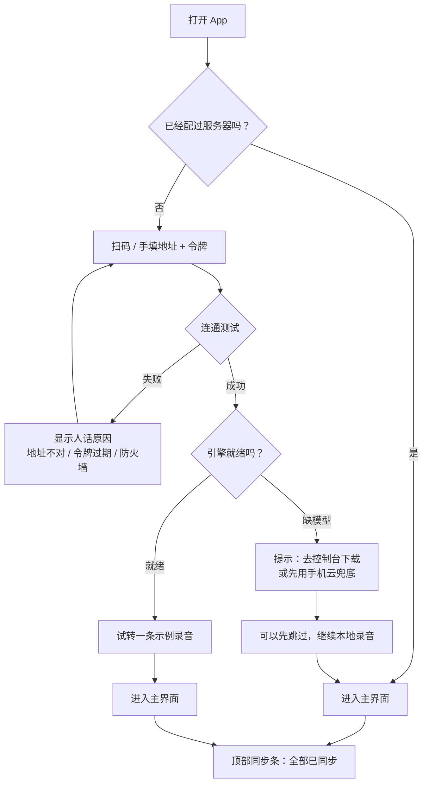
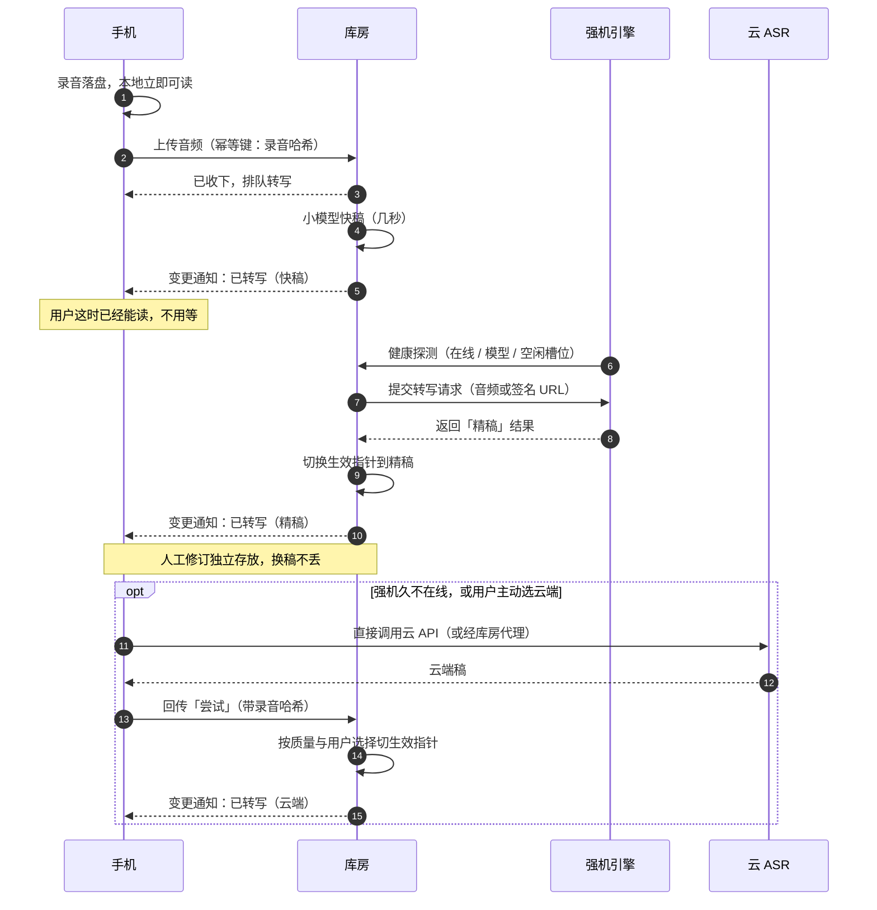
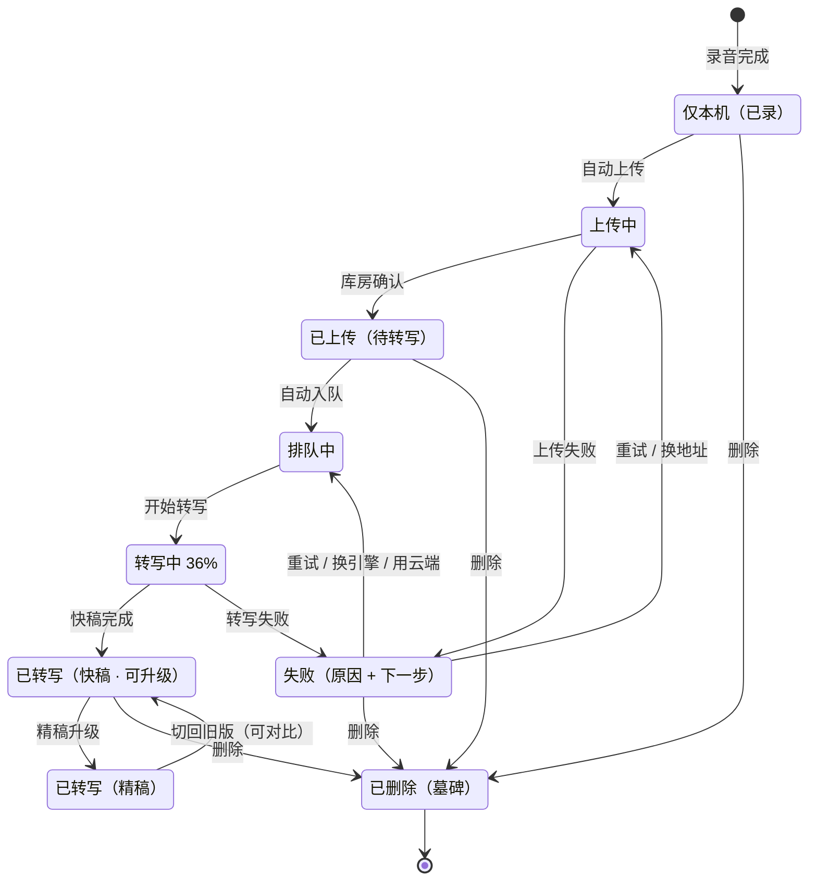
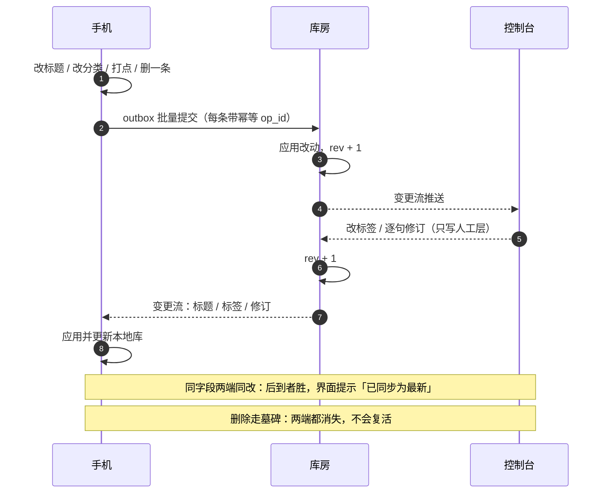
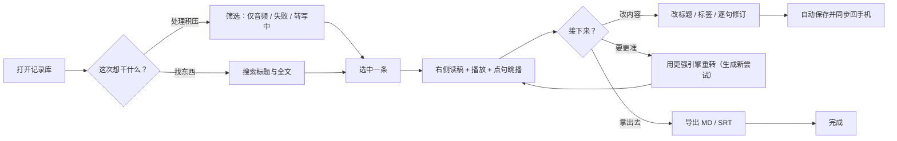
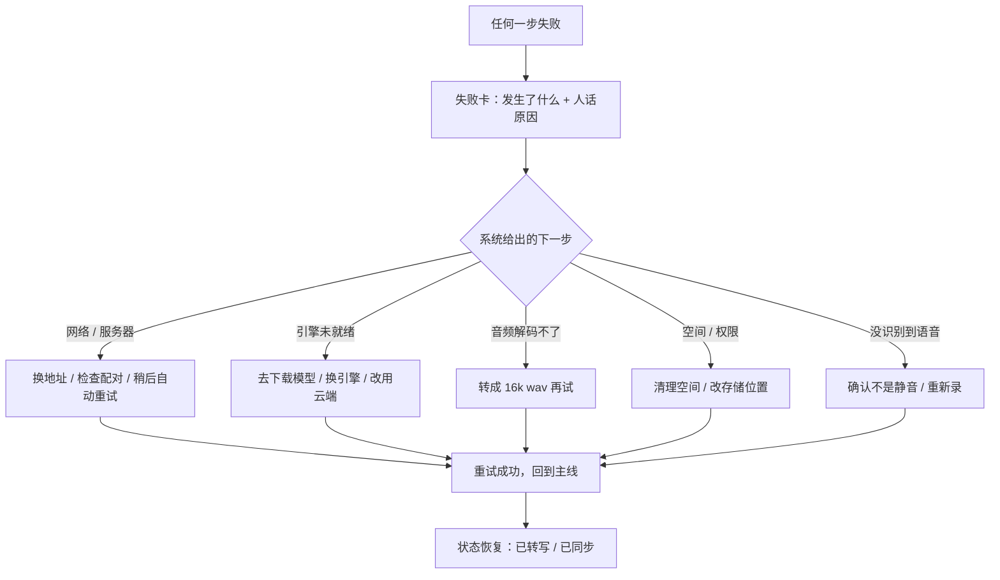
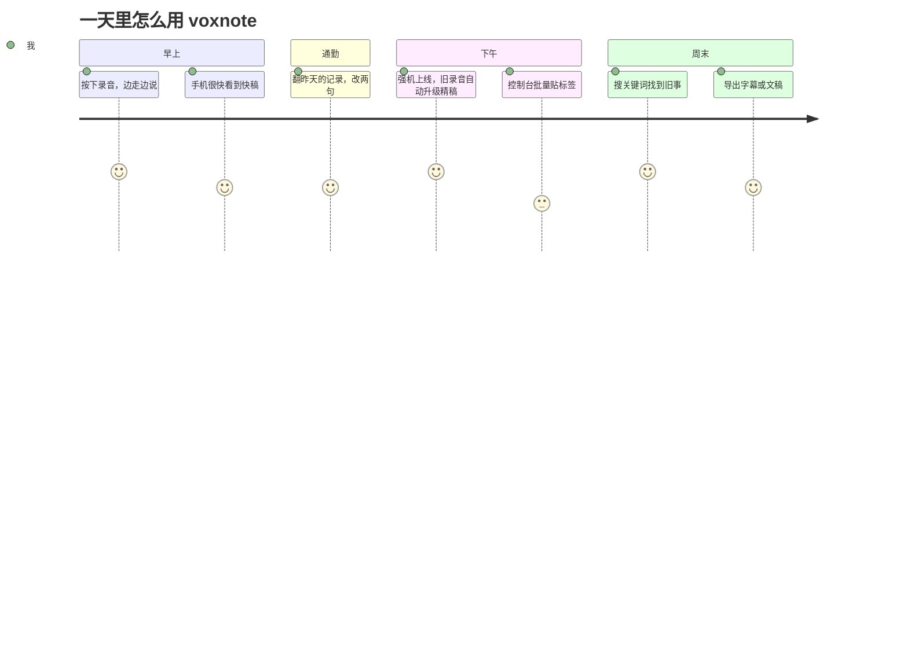

# 合理使用流程（目标形态）

> 2026-10-26。配合 [重设计准备](../设计/重设计准备.md) 阅读：本文画的是**重设计之后应该有**的使用流程，
> 不是现在的实现。想对照"现在实际怎么跑"，见 [现在的流程](现有流程.md)。
> 所有 mermaid 图可在 GitHub / Typora / Obsidian / mermaid.live 直接渲染。
>
> 一条原则贯穿全文：**库房、远程引擎、云这些角色对用户不可见**。用户只需要看到
> "录了 → 在转 → 能读了 → 更准了 → 改过的都还在"，不需要知道是谁在转。

## 1. 一张图看懂主线

要点：**先出快稿保底，再按条件升级**。用户永远不用等"最强的那台机器开机"才能读。

## 2. 第一次使用：配对与就绪

要点：**允许跳过**。没有服务器也能录音和本地阅读，只是"暂不同步"；
不能因为配置没完成就把用户挡在门外。

## 3. 日常一条录音的完整时序

要点：三个转写来源产出的是**三份不可变的"尝试"**，记录的只是"哪一份生效"。
所以同时发生也不会互相覆盖，手机离线云转写回来也不打架。

## 4. 一条记录的一生（状态机）

要点：对用户只暴露**一个状态**；失败一定有"下一步"；"更准的稿到了"是升级，不是状态回退。
用户也可以主动"钉住"某一版，不被自动升级覆盖。

## 5. 多端一致：改标题、删记录、改句子

要点：手机**先写本地再同步**，所以断网也能改；恢复后自动补上，不会丢也不会重复。
人工修订只写人工层，重转写永不覆盖。

## 6. 控制台里怎么整理

要点：控制台的主线只有一件——**读和改**。队列状态长在列表上，不再单独一个"任务页"。

## 7. 失败时用户看到什么（统一失败卡）

要点：所有失败共用一个卡片样式，永远包含"原因 + 动作"；
原始异常折叠起来给排查用，不直接甩给用户。

## 8. 一天里怎么用（用户视角）

## 9. 入口对照表（谁在哪做什么）

| 用户想做的事 | 手机 | 控制台 | 说明 |
| --- | --- | --- | --- |
| 录一条 | 首页大按钮 | — | 录完自动入库 |
| 看同步/转写进度 | 顶部同步条 → 同步中心 | 记录库状态 + 活动中心 | 同一套状态词 |
| 读、改、打点 | 详情页 | 详情页 | 改完自动同步 |
| 要更准的稿 | 详情任务卡「用更准的重转」 | 记录详情「重新转写」 | 生成新尝试，可切回 |
| 配服务器 | 设置 → 服务器地址簿 | 设置 → 配对二维码 | 首次向导 |
| 看引擎/模型状态 | 只读 | 系统状态页 | 手机不猜 |
| 删记录 | 详情 / 批量 | 记录详情 | 墓碑，双向消失 |
| 找东西 | 搜索 | 搜索（全文） | 同一套筛选语义 |

## 10. 验收这组流程（5 个任务）

1. 新用户：扫码配对 → 引擎就绪 → 转出一条，≤3 分钟；
2. 断网：飞行模式录一条 → 恢复网络 → 自动上传并出稿；
3. 失败：故意让引擎不可用 → 用户能看懂原因并修好；
4. 一致：手机改标题、删一条 → 控制台刷新后一致，且不复活；
5. 多来源：手机云转一条 + 库房转一条 + 远程强机升级一条 → 三版共存、可切换、人工修订不丢。

全过 = 流程合理；任何一项卡住，回到对应图改路径，而不是加按钮。
