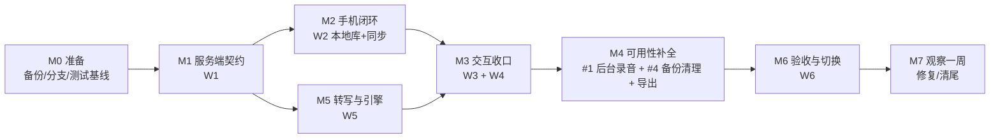

# V1 行动计划（完整）

> 2026-10-26。目标：按 [结构设计](../设计/架构设计.md) 做出一版**可日用的单机 V1**：
> 录得可靠、同步不丢、转写可见、冲突可选、数据能备份。
>
> 计划按"工作包 + 里程碑 + 验收门"组织；估算是**人日量级**（AI 辅助可压缩），
> 不是承诺日期。范围一旦冻结，新想法进 backlog，不在 V1 里加。

## 0. 原则

1. **先把数据做对，再做界面**：SQLite / rev / changes / attempts / conflicts 先落地；
2. **一条主路径**：录 → 同步 → 快稿 → 读/改 → 冲突选择 → 备份；
3. **每个阶段可验收**：没有"做完了但不知道对不对"；
4. **破坏性重建**：不迁移历史数据；切换前必须备份；
5. **不扩范围**：V1 只做本计划列出的东西。

## 1. V1 范围

**做**

- 录音：前台服务 + 通知 + 中断恢复（#1）
- 列表 / 详情 / 搜索 / 筛选 / 改名 / 标签分类 / 打点
- 自动上传 + 变更流同步 + 离线 outbox + 冲突提醒与选择
- 转写：库房快稿 + 手动触发 + 可配置多个 OpenAI 兼容引擎（**手动选，不自动切换**）
- 导出 md / srt（单条）
- 自动连播开关（记录页，播完下一条）
- 设置：服务器地址、引擎配置、保留策略、存储管理、诊断
- 备份 / 保留 / 清理（#4）+ 恢复演练
- 控制台：记录库（含冲突/diff）/ 同步与设备 / 系统状态 / 设置

**暂不做（隐藏入口，代码保留）**

录音流独立页、AI、批量管理、多引擎自动切换（#8）、摘要/待办/关键词、厂商导入插件、
云端独立页、多用户、多机部署、发布签名/分发。

**后置 issue**：#2 整库导出、#3 说话人身份、#5 清尾、#6 转写质量、#7 安全边界、#8 自动切换。
**明确不做**：多主/自动选主/实时协作、抓厂商私有数据、Android 第三方框架、绑定单一云。

## 2. 交付物

| 类别 | 交付物 |
| --- | --- |
| 服务端 | `/api/v2`（changes/manifest/upload/ops/conflicts/attempts/jobs/engines/backup）、SQLite v2、OpenAI 兼容适配器、控制台 |
| Android | V2 APK：本地 SQLite、SyncEngine、后台录音、新列表/详情/同步中心/设置 |
| 脚本 | 假引擎、备份、端到端 5 脚本、性能基准、切换 runbook |
| 文档 | 契约 v2、运行手册（切换/回滚/备份）、用户指南、本计划 |

## 3. 工作分解

估算：S ≤ 1 天，M 2–3 天，L 4–6 天。

### W0 准备与安全网（3 天）

| ID | 任务 | 产出 | 验收 |
| --- | --- | --- | --- |
| W0-1 | 备份旧数据 | `backup/<日期>/`：server data、手机数据目录、app-state；校验和清单 | 能在临时目录恢复一份并起旧服务 |
| W0-2 | 分支策略 | `v1-legacy` 标签；`v2` 集成分支；`v2/server`、`v2/android`、`v2/web` | 分支建好，README 写明 |
| W0-3 | 测试基线 | 临时数据目录脚本、**假 OpenAI 兼容引擎**、5 个验收脚本骨架 | `./scripts/e2e.sh` 能跑通空库 |
| W0-4 | 运行自检 | 检查 Python/依赖/ffmpeg/模型目录的脚本 | 缺什么直接报人话 |

### W1 服务端 v2 数据与协议（9 天）

| ID | 任务 | 产出 | 验收 |
| --- | --- | --- | --- |
| W1-1 | 新 schema | records/attempts/attempt_segments/edits/jobs/devices/engines/conflicts/changes/settings | 空库初始化 + 迁移版本号 |
| W1-2 | rev + changes + 墓碑 | `GET /sync/changes` 分页、删除事件、sync_hash | 脚本验证增/改/删、分页追平 |
| W1-3 | 上传幂等 | `POST /sync/upload`：Idempotency-Key + audio_sha256 | 重复上传不产生副本 |
| W1-4 | ops + 冲突 | `POST /sync/ops`（幂等、base_rev）、conflicts 表/API | 两端同改产生冲突，不静默覆盖 |
| W1-5 | manifest 对账 | `GET /sync/manifest`、`resync_required` | 清空游标后能全量对齐 |
| W1-6 | attempts + 指针 | 尝试不可变、active_attempt、切换 API | 多来源共存，切版不丢 |
| W1-7 | 记录 API | list/detail/transcript by attempt/audio Range/export md+srt | 与契约测试一致 |
| W1-8 | 引擎适配器 | OpenAI 兼容（verbose_json/stream/错误/超时）；多引擎配置 | 假引擎 + 真引擎各跑一条 |
| W1-9 | 备份/保留/清理 | 备份、恢复、保留策略、存储管理 API | 备份→清空→恢复一致 |
| W1-10 | 诊断 | `/health`、`/diagnostics`、队列/引擎/磁盘指标 | 能回答"为什么没转/没同步" |

### W2 Android 底座（9 天）

| ID | 任务 | 产出 | 验收 |
| --- | --- | --- | --- |
| W2-1 | 本地 SQLite | records/attempts/edits/jobs/outbox/sync_state，单写者 + 观察者 | 增删改查 + 变更通知 |
| W2-2 | 录音落库 | 复用 Storage，写记录 + 音频 hash | 录完立刻能在本地读到 |
| W2-3 | SyncEngine | outbox 推送、changes/manifest 拉取、退避、冲突入队 | 断网/恢复/重复投递正确 |
| W2-4 | 状态映射 | 本地 + 服务器 + outbox → 一个展示状态 | 状态词表全对得上 |
| W2-5 | 后台录音（#1） | 前台服务 + 通知 + 中断/被杀恢复 | 锁屏 10 分钟完整，来电中断可恢复 |
| W2-6 | 导出 | 单条 md/srt（调服务器或本地生成） | 文件内容正确、可打开 |

### W3 手机 UI 收敛（7 天）

| ID | 任务 | 产出 | 验收 |
| --- | --- | --- | --- |
| W3-1 | 列表 | 顶部同步条、筛选、搜索、**自动连播开关** | 主路径无多余入口 |
| W3-2 | 详情 | 播放条、任务卡（进度/失败动作）、逐句、打点、改名/标签 | 转写中不重建全部句 |
| W3-3 | 冲突 UI | 冲突列表 + 两边 diff + 选本地/服务器/合并 | 两种冲突都能解决 |
| W3-4 | 同步中心 | 待上传/转写中/失败/冲突 + 单条/全部重试 | 一眼知道在干嘛 |
| W3-5 | 设置重组 | 地址簿、引擎（可多配、手动选）、保留、存储管理、诊断、导出 | 旧死配置消失 |
| W3-6 | 配对向导 | 扫码→连通→引擎就绪→试转一条 | 新用户 3 分钟闭环 |
| W3-7 | 隐藏旧入口 | 录音流/AI/批量等入口隐藏，代码保留 | 主界面只剩 V1 范围 |

### W4 控制台（7 天）

| ID | 任务 | 产出 | 验收 |
| --- | --- | --- | --- |
| W4-1 | IA 收敛 | 记录库 / 同步与设备 / 系统状态 / 设置 | 导航不再有重叠页 |
| W4-2 | 记录库 + 详情 | 状态列、逐句修订、版本 diff、冲突处理、导出 | 与手机同一套语义 |
| W4-3 | 引擎页 | 多引擎配置、健康、手动选择、失败提示 | 不做自动切换 |
| W4-4 | 存储页 | 保留策略、备份、清理、占用预览 | 清理前有确认与占用 |
| W4-5 | SSE + 增量渲染 | 事件流替代 3 秒轮询 | 任务/记录状态实时 |
| W4-6 | 诊断/活动中心 | 失败、同步、任务时间线 | 能定位一条记录的问题 |

### W5 转写与引擎（6 天，部分与 W1 并行）

| ID | 任务 | 产出 | 验收 |
| --- | --- | --- | --- |
| W5-1 | 库房快稿 | 现有本地引擎接新队列，快稿 quality=2 | 上传后秒级出稿 |
| W5-2 | readiness + 模型目录 | `data/models`、校验、下载/删除、磁盘预算 | 未就绪有显式状态与动作 |
| W5-3 | 队列完善 | 手动优先、阶段进度、取消、错误码、重试 | 手机/控制台进度一致 |
| W5-4 | 云端调用 | 隐私提示、失败提示手选、无自动切换 | 提示只在出网时出现 |

### W6 验收与切换（5 天）

| ID | 任务 | 产出 | 验收 |
| --- | --- | --- | --- |
| W6-1 | 5 个任务脚本 | 新用户/断网/失败/一致性/多来源 | 全部 ≤3 分钟通过 |
| W6-2 | 性能基准 | 1k 记录、1h 音频、详情、搜索、同步 | 达 §12 预算 |
| W6-3 | 备份/恢复演练 | 备份→新库→恢复→对账 | 数据一致 |
| W6-4 | 破坏性切换 | 备份→清空/换新库→上线→冒烟 | 回滚可用 |
| W6-5 | 文档收口 | 契约 v2、runbook、用户指南、README | 与实现一致 |

## 4. 依赖与关键路径

关键路径：**M0 → M1 → M2 → M3 → M6**。
可并行：W1-8/W5（引擎）与 W2；#1 后台录音可与 W2 并行；控制台 W4 可与 W3 并行。

## 5. 里程碑与验收门

| 里程碑 | 内容 | 验收门（Gate） |
| --- | --- | --- |
| M0 | 备份、分支、假引擎、脚本骨架 | 旧数据可恢复；`e2e.sh` 空库跑通 |
| M1 | 服务端 v2 契约冻结 | changes/manifest/upload/ops/conflicts/attempts 契约测试通过 |
| M2 | 手机核心闭环 | 录一条 → 上传 → 快稿 → 手机能读；断网重连不丢 |
| M3 | 交互收口 | 同步中心/任务卡/冲突选择/设置重组可用；控制台新 IA 可用 |
| M4 | 可用性补全 | 锁屏录音 10 分钟；备份→恢复；md/srt 导出 |
| M6 | 验收与切换 | 5 个脚本 + 性能 + 备份演练全过；破坏性切换完成 |
| M7 | 上线观察 | 连续 7 天无静默失败；卡点进 backlog |

## 6. 第一周具体安排

| 天 | 任务 | 当日产出 |
| --- | --- | --- |
| D1 | W0-1 备份 + W0-2 分支 + W0-3 假引擎 | 备份包、分支、假引擎能回固定结果 |
| D2 | W1-1 schema + W1-2 changes 骨架 | 空库可起、`/sync/changes` 可返回 |
| D3 | W1-3 上传幂等 + W1-7 最小 list/detail | 假引擎上传→记录→列表可查 |
| D4 | W1-4 ops + conflicts 骨架 | 改名/删除同步；同改产生冲突 |
| D5 | W0-3 e2e 第一版 | "上传→转写→changes→冲突"脚本跑通 |
| D6–D7 | W2-1 Android SQLite + W2-3 骨架 | 本地库建好，能拉一条记录 |

每天结束跑：`e2e.sh` + 备份可用性检查。**M0/M1 没通过不进 W2。**

## 7. 测试与验收策略

- **服务端契约测试**：Python unittest + httpx，临时数据目录；假引擎固定输出；
- **端到端**：脚本启动服务、上传 fixture 音频、等等转写、检查 changes/冲突/导出；
- **Android**：无第三方测试框架，用"构建 + 安装 + 5 个任务脚本"人工/半自动回归；
- **故障注入**：断网、杀进程、断电、磁盘满、token 过期、引擎超时/返回垃圾；
- **性能**：生成 1k 记录 + 1 小时音频的合成库，测冷启动/详情/增量；
- **验收以 [目标流程 §10](../流程/目标流程.md) 的 5 个任务脚本为准**，不做"点一遍看着正常"。

## 8. 切换与回滚 Runbook（破坏性）

1. **备份**：旧 `server/data/`、手机 `/sdcard/s1rec/`、`app-state.json` → `backup/<日期>/`，记录校验和；
2. **停旧服务**；保留旧目录不动；
3. **起 v2**：新数据目录空库；确认 engine 就绪；
4. **手机配对**新服务器，冒烟：录一条、转一条、改一条、删一条、导出；
5. **验收 5 脚本**；
6. **观察一周**；
7. **回滚**：停 v2 → 恢复旧目录/旧 APK → 起旧服务（旧数据未被改写）。

## 9. 风险与对策

| 风险 | 对策 |
| --- | --- |
| 范围膨胀（已加 #1/#4/导出/连播） | 冻结本计划；新需求只进 backlog |
| 冲突 UI 复杂 | 先做"提示 + 选一边"；逐项合并后置 |
| 后台录音机型差异 | W2-5 提前做；真机锁屏测试，失败降级并提示 |
| OpenAI 兼容实现差异 | 适配器 + 假引擎；只依赖 text/verbose_json 最小集 |
| 破坏性切换丢数据 | 强制备份 + 回滚 runbook；切换前演练一次 |
| 0 测试基础 | W0 先建脚本，后续每个任务带验收 |
| 时间估算偏差 | 按里程碑验收，不按日期压进度 |

## 10. 完成定义（DoD）

- [ ] 5 个任务脚本全过；0 个"静默失败"；
- [ ] 锁屏录音 10 分钟完整；来电中断可恢复；
- [ ] 改名/标签/删除/修订双向一致；冲突必须提醒并能选择；
- [ ] 多引擎可配置、手动选择；失败只提示，不自动切换；
- [ ] 导出 md/srt 可用；自动连播开关可用；
- [ ] 备份→恢复演练通过；保留策略在设置可配；
- [ ] 控制台无 3 秒轮询、无重叠页面；
- [ ] 文档（契约/runbook/用户指南/README）与实现一致；
- [ ] 旧数据已备份；回滚步骤演练过。

## 11. Issue 映射

| Issue | 处理 |
| --- | --- |
| #1 后台录音 | **V1 内**（W2-5 / M4） |
| #4 备份/保留/清理 | **V1 内**（W1-9、W4-4、W6-3） |
| #2 整库导出/导入 | 后置 |
| #3 说话人身份 | 后置 |
| #5 清尾（时间/搜索/引擎/测试/交互） | 后置 |
| #6 转写质量策略 | 后置 |
| #7 安全边界 | 后置 |
| #8 多引擎自动切换 | 后置 |

## 12. 后续版本（Post-V1）

- V1.1：录音流完整版、批量管理、整库导出/导入（#2）
- V1.2：说话人身份（#3）、质量策略（#6）
- V1.3：安全边界（#7）、多引擎自动切换（#8）
- V2：多机部署（远程引擎/热备/中转）
